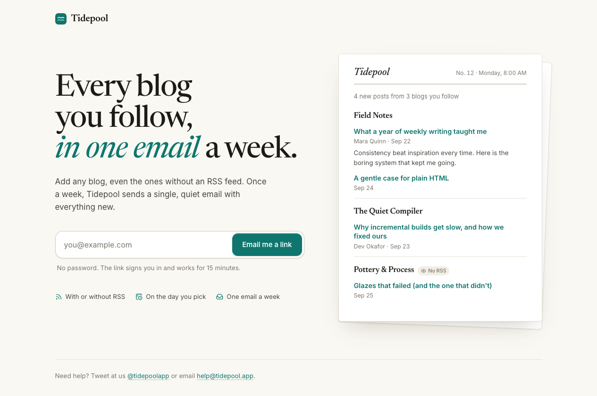
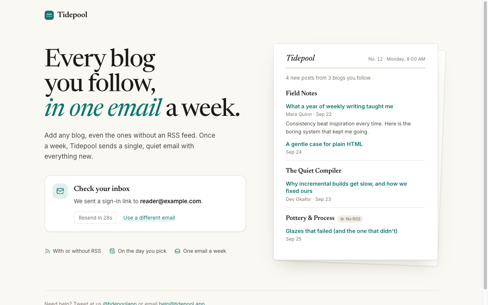
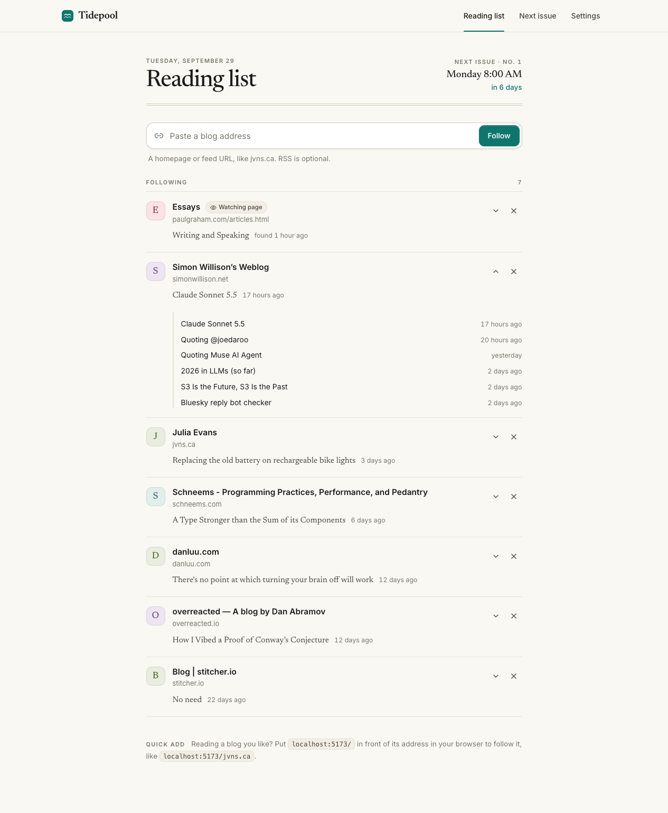
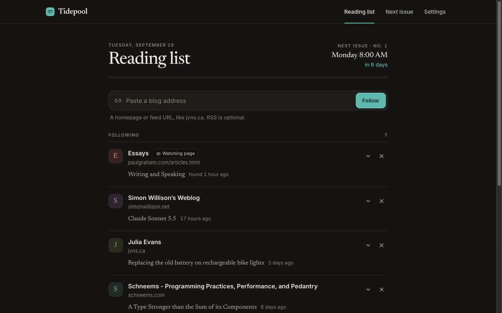
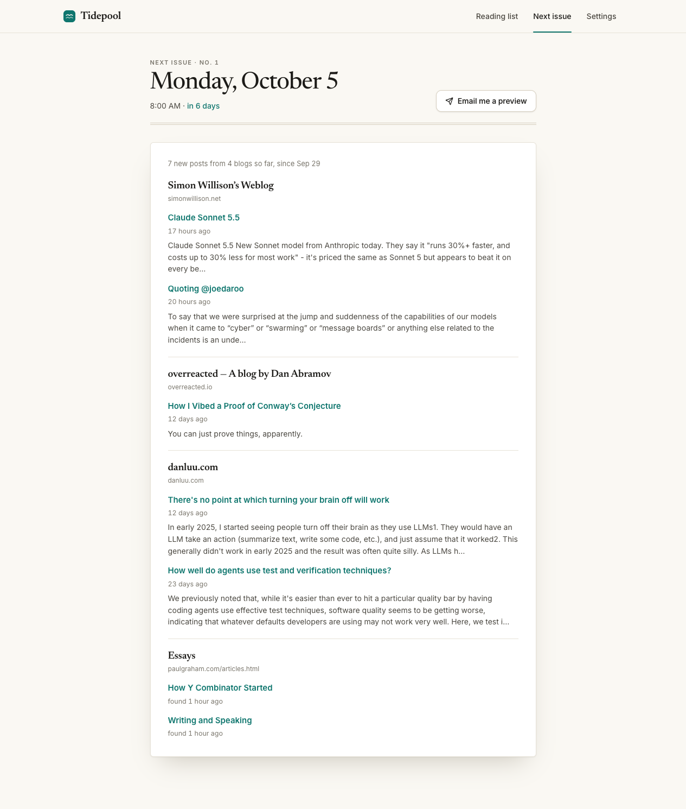
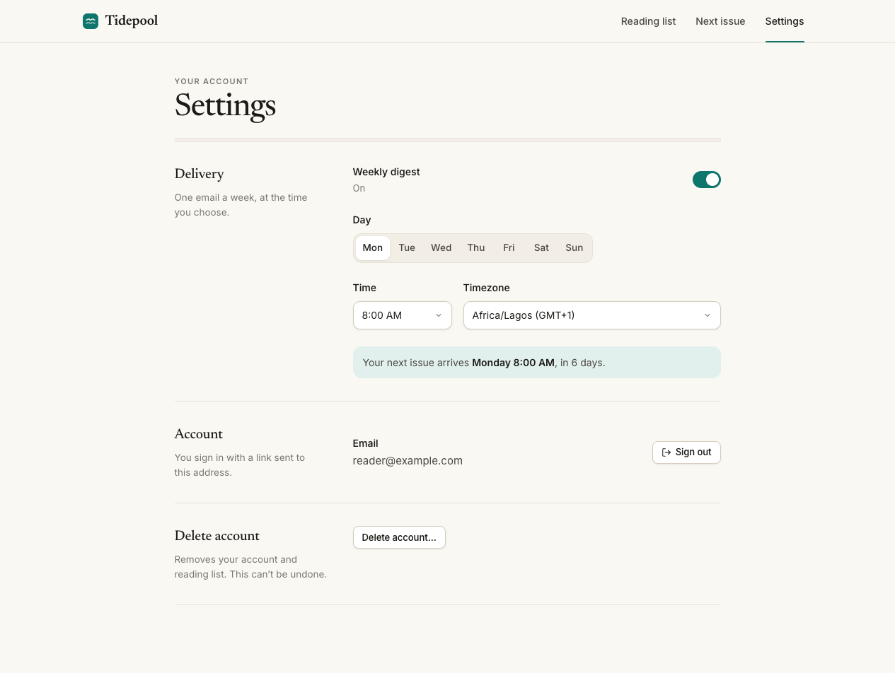
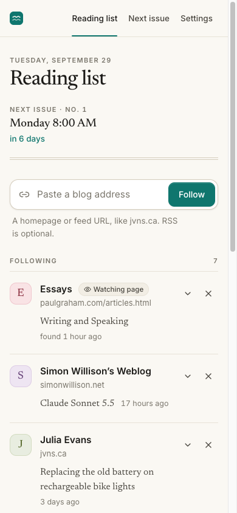
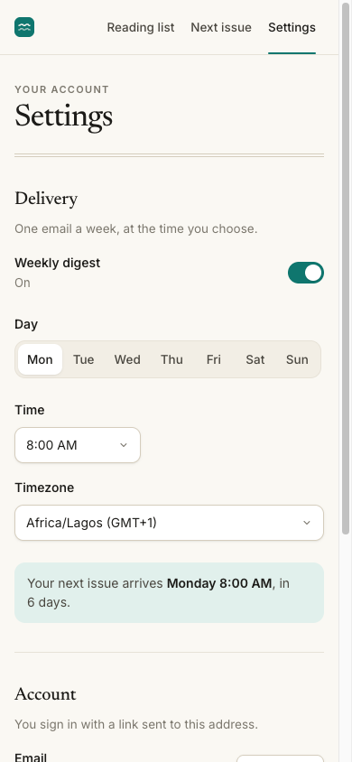
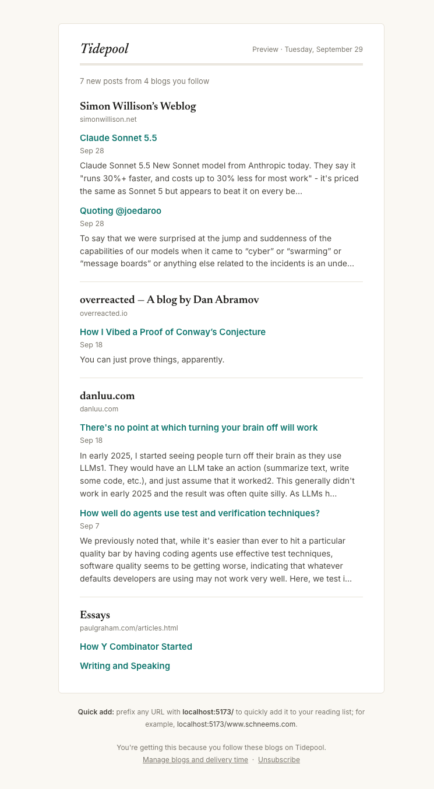
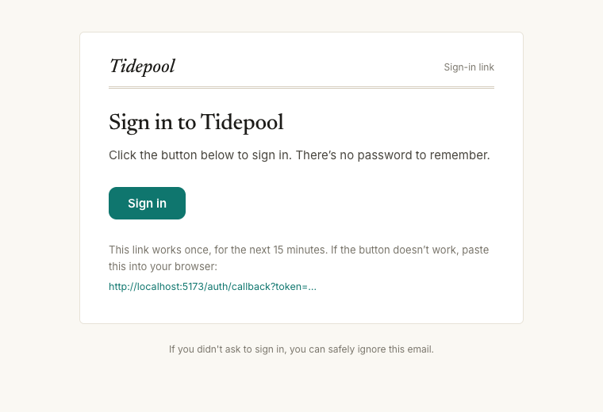

# Tidepool

One email a week with all the new posts from the blogs you follow — even the
ones without an RSS feed.

- **API** (repo root): NestJS 12 with Postgres (Prisma 7), Redis (BullMQ) and
  SMTP (Nodemailer).
- **Web app** ([`web/`](web/README.md)): Vue 3 + Vite. Run it with
  `cd web && npm install && npm run dev`, then open <http://localhost:5173>.
- **Docs** ([`docs/`](docs/Home.md)): an Obsidian vault with architecture,
  decisions, runbooks, the changelog and a feature tracker. Open `docs/` as a
  vault in Obsidian.

## Screenshots

### Landing page and sign-in

Sign in with an emailed magic link; no password.





### Reading list

Follow any blog by URL, with or without RSS. Blogs without a feed are watched
by checking the page itself ("Watching page"). Expand a blog to see its recent
posts; the masthead shows when the next issue arrives.





### Next issue

A preview of the next digest, laid out like the email, with past issues below.



### Settings

Delivery day, time and timezone (saved as you change them), pause, sign out and
delete account.



### On a phone

<table>
  <tr>
    <td></td>
    <td></td>
  </tr>
</table>

### Emails

The weekly digest and the sign-in email share the web app's design: a numbered
issue with a masthead, grouped by blog.

<table>
  <tr>
    <td valign="top"></td>
    <td valign="top"></td>
  </tr>
</table>

## Local setup

```bash
cp .env.example .env          # then set JWT_SECRET to a long random string
docker compose up -d          # Postgres :5433, Redis :6380, Mailpit :1025/:8025
npm install                   # also runs `prisma generate`
npm run db:migrate            # apply migrations
npm run start:dev
```

Outgoing email is caught by Mailpit: <http://localhost:8025>

## Scripts

| Script               | What it does                             |
| -------------------- | ---------------------------------------- |
| `npm run start:dev`  | API with watch mode                      |
| `npm test`           | Unit tests (Vitest)                      |
| `npm run test:e2e`   | E2E tests — needs `docker compose up -d` |
| `npm run lint`       | oxlint                                   |
| `npm run db:migrate` | Create/apply migrations in development   |
| `npm run db:deploy`  | Apply migrations in production           |

## Security notes

Tidepool fetches arbitrary user-supplied URLs, so all outbound HTTP goes through
[`safeFetch`](src/common/safe-fetch.ts): http(s) only, private/loopback/link-local
addresses are refused at connect time (so DNS rebinding is covered too), plus
timeouts, a redirect cap and a 20 MB response limit.

## API

All routes need `Authorization: Bearer <accessToken>` unless marked public.

| Method | Path                          | Auth   | Description                                                                                      |
| ------ | ----------------------------- | ------ | ------------------------------------------------------------------------------------------------ |
| GET    | `/health`                     | public | Liveness + DB check                                                                              |
| GET    | `/stats`                      | public | Aggregate numbers for the `/open` page (cached 5 min; blogs listed only with 2+ followers)       |
| GET    | `/shared/:id`                 | public | A shared reading list: blogs by their own titles, never the reader                               |
| POST   | `/auth/magic-link`            | public | `{ email }` → emails a sign-in link to `FRONTEND_URL/auth/callback?token=…`                      |
| POST   | `/auth/verify`                | public | `{ token, timezone? }` → `{ accessToken, user }`                                                 |
| GET    | `/me`                         | ✓      | Current user and digest settings                                                                 |
| PATCH  | `/me`                         | ✓      | `{ digestEnabled?, digestDay? (0=Sun), digestHour?, timezone? }`                                 |
| POST   | `/me/share`                   | ✓      | Turn on your shared list; `{ reset: true }` makes a new link                                     |
| DELETE | `/me/share`                   | ✓      | Turn sharing off                                                                                 |
| DELETE | `/me`                         | ✓      | Delete account and all subscriptions                                                             |
| GET    | `/blogs`                      | ✓      | Blogs you follow, with health and latest post                                                    |
| POST   | `/blogs`                      | ✓      | `{ url }` → follow a blog (homepage or feed URL, scheme optional)                                |
| POST   | `/blogs/batch`                | ✓      | `{ urls }` (up to 10) → follow each, reporting `followed`, `already` or `failed` per URL         |
| GET    | `/blogs/export.opml`          | ✓      | Download the blogs you follow as an OPML file                                                    |
| GET    | `/blogs/:id`                  | ✓      | One followed blog                                                                                |
| GET    | `/blogs/:id/posts`            | ✓      | Recent posts, `?limit=` 1–100 (default 20)                                                       |
| PATCH  | `/blogs/:id`                  | ✓      | `{ title?, paused? }`: your own name for the blog (`null` restores it) and pausing it in digests |
| DELETE | `/blogs/:id`                  | ✓      | Unfollow                                                                                         |
| GET    | `/digests`                    | ✓      | Last 20 digests sent to you                                                                      |
| GET    | `/digests/preview`            | ✓      | What your next digest would contain right now                                                    |
| POST   | `/digests/test`               | ✓      | Email yourself the preview (3/hour, doesn't affect your schedule)                                |
| GET    | `/digests/unsubscribe?token=` | public | Confirm page linked from every digest                                                            |
| POST   | `/digests/unsubscribe?token=` | public | Unsubscribe (confirm button and RFC 8058 one-click)                                              |

### Sign-in flow

1. Frontend posts the email to `/auth/magic-link` (always `202`, so it can't be
   used to check which emails have accounts).
2. The user clicks the link, the frontend reads `?token=` and posts it to
   `/auth/verify` along with the browser's timezone.
3. The account is created on first verify. Links are single-use and expire after
   `MAGIC_LINK_TTL_MINUTES`.

### How blogs are followed

When a URL is added, [`DiscoveryService`](src/feeds/discovery.service.ts) looks
for a feed in this order:

1. The URL is itself an RSS, Atom or JSON Feed.
2. Feeds advertised with `<link rel="alternate">` on the page.
3. Common locations (`/feed`, `/rss.xml`, `/feed.xml`, `/atom.xml`, `/index.xml`,
   `/rss`) under the page path and the site root.
4. No feed: **scrape mode**. The page is re-fetched on every check, and links
   that look like posts (headings, `<article>`) and weren't there before
   count as new posts.

Blogs are shared between users and fetched once per `FETCH_INTERVAL_MINUTES`
through the BullMQ `feed-fetch` queue. Failures back off exponentially. Posts
that already existed when a blog was first fetched are stored as `backfill` and
never emailed.

### How digests are sent

Every 15 minutes [`DigestScheduler`](src/digest/digest.scheduler.ts) queues a
job for each user whose chosen day and hour (in their timezone) is now. Users
who got a digest in the last 6 days are skipped. The job:

1. Claims the week by setting `lastDigestSentAt` with a compare-and-set, so
   concurrent workers or instances can't double-send.
2. Collects posts discovered since the previous digest, only from blogs
   followed before the post appeared, skipping backfill and anything published
   more than 30 days ago.
3. Sends nothing if there's nothing new; otherwise emails it. If sending fails,
   the claim is released and BullMQ retries.

Unsubscribe links carry a signed token that can't be used to sign in. The GET
link only shows a confirm button, because mail scanners prefetch links.
