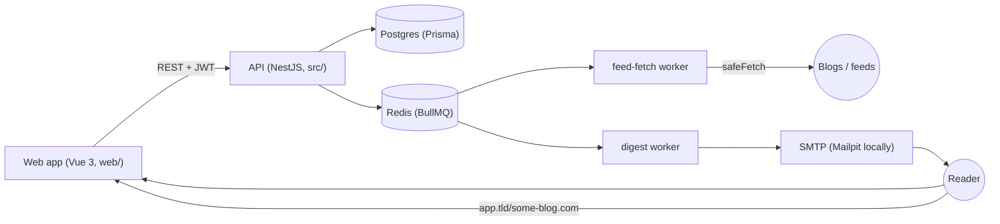

# Architecture

## Modules

| Module | Path | Responsibility |
|---|---|---|
| Auth | `src/auth/` | Magic links, JWT access tokens, global guard ([[Decisions#Magic-link sign-in]]) |
| Users | `src/users/` | `/me` settings: day, hour, timezone, pause |
| Blogs | `src/blogs/` | Follow/unfollow, rename, pause, recent posts |
| Feeds | `src/feeds/` | Discovery, parsing, scraping, scheduled fetching |
| Digest | `src/digest/` | Weekly scheduling, sending, preview, unsubscribe |
| Mail | `src/mail/` | SMTP transport and the branded templates |
| Stats | `src/stats/` | Public `/stats` for the `/open` page |
| Common | `src/common/` | `safeFetch` ([[Decisions#SSRF-safe fetching]]), URL normalising, decorators |

## Flows

**Following a blog** (`POST /blogs`): normalise the URL → reuse the blog if
anyone already follows it → otherwise discover a feed (direct feed, `<link
rel=alternate>`, common paths) or fall back to scraping the page → first fetch
stores existing posts as backfill ([[Decisions#Backfill baseline]]).

**Fetching** (`FetchScheduler`, every 5 minutes): queue due blogs that still
have followers, lease them 30 minutes, fetch in `FetchProcessor` (concurrency
10). New posts get `discoveredAt = now`. Failures back off exponentially.

**Digests** (`DigestScheduler`, every 15 minutes): queue readers whose local
day and hour is now and who had no digest in 6 days. `DigestService.send`
claims the week with a compare-and-set on `lastDigestSentAt`, collects posts
discovered since the last digest from unpaused follows, emails them, and
records a `Digest`. A mail failure releases the claim so BullMQ retries.

See also: [[Data model]], [[API]], [[Local development]].
