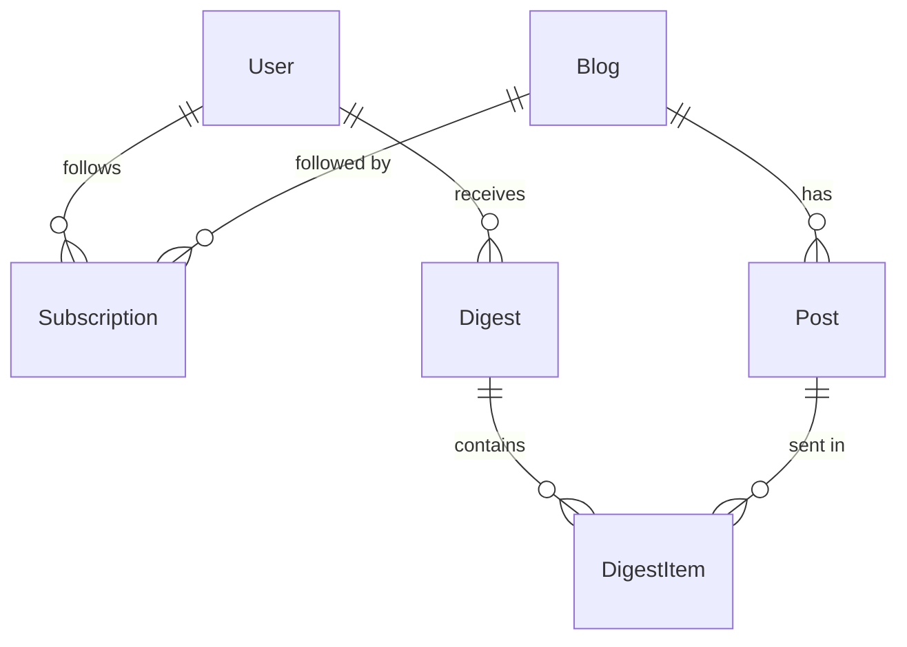

# Data model

Source of truth: `prisma/schema.prisma`. Migrations live in `prisma/migrations/`.

| Model | Notes |
|---|---|
| `User` | `digestDay` (0 = Sunday), `digestHour` (0–23), `timezone` (IANA), `digestEnabled`, `lastDigestSentAt` (the weekly claim) |
| `LoginToken` | Keyed by **email**, stores only a SHA-256 hash; a `User` is created on first verify |
| `Blog` | Shared by all readers. `sourceUrl` (feed or page) is unique; `fetchMode` is `FEED` or `SCRAPE`; fetch health in `consecutiveFailures`, `lastError`, `nextFetchAt` |
| `Subscription` | One reader following one blog. `customTitle` (their own name) and `paused` (left out of their digests) — see [[Rename and pause blogs]] |
| `Post` | Unique on `(blogId, url)`. `backfill = true` for posts that existed at first fetch; they are never emailed |
| `Digest` / `DigestItem` | What was sent, when, and which posts |

> [!warning] Prisma 7
> `prisma migrate dev` does **not** regenerate the client. Run
> `npx prisma generate` after changing the schema.
